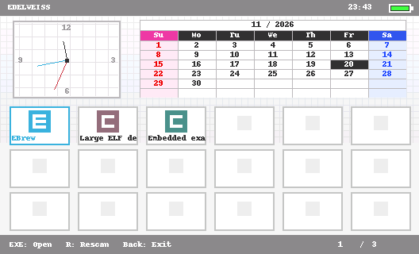

# Edelweiss for EX-word

Edelweiss is an embeddable EXWord addin (d01) loader for elf (`.edl`).
This codebase is adapted from [MPM](https://git.planet-casio.com/PlaneteCasio/mpm) and [hollyhock](https://github.com/ClasspadDev/hollyhock-3), and adds a sample EBrew launcher



**Experimental hardware build:** This port uses specific upper-RAM arena.
Untested firmware are rejected, 

## Install and try

Download **Edelweiss-ja** or **Edelweiss-cn** from the
[EX-word workflow](https://github.com/TheRainbowPhoenix/Edelweiss/actions/workflows/exword.yml).
Each artifact contains two installation folders:

```text
EDELW/
  edelweiss.d01       resident loader, below the native 128 KiB limit
  EBrew.edl          ELF home screen, larger than 128 KiB
  large-demo.edl     independent large ELF example
  diction.htm, ...   locale-specific install metadata
  fileinfo.cji
EXMPL/
  example.d01        identical stage 0 under a different filename
  main.edl           launches directly without the EBrew menu
  diction.htm, ...
  fileinfo.cji
```

Install these folders with the [usual EX-word add-in transfer tool](https://github.com/TheRainbowPhoenix/libexword-re), that will places
program content under `_CONTENT`. When adding files to already-installed
content, keep the EDL adjacent to the D01:

```text
\\drv0\EDELW\_CONTENT\edelweiss.d01
\\drv0\EDELW\_CONTENT\EBrew.edl
\\drv0\EDELW\_CONTENT\large-demo.edl
\\crd0\CASIO\EXMPL\_CONTENT\example.d01
\\crd0\CASIO\EXMPL\_CONTENT\main.edl
```

EBrew discovers `*.edl` in each application's `_CONTENT` folder under
`\\drv0`, `\\drv0\CASIO`, `\\crd0\CASIO`, and `\\crd1\CASIO`.
